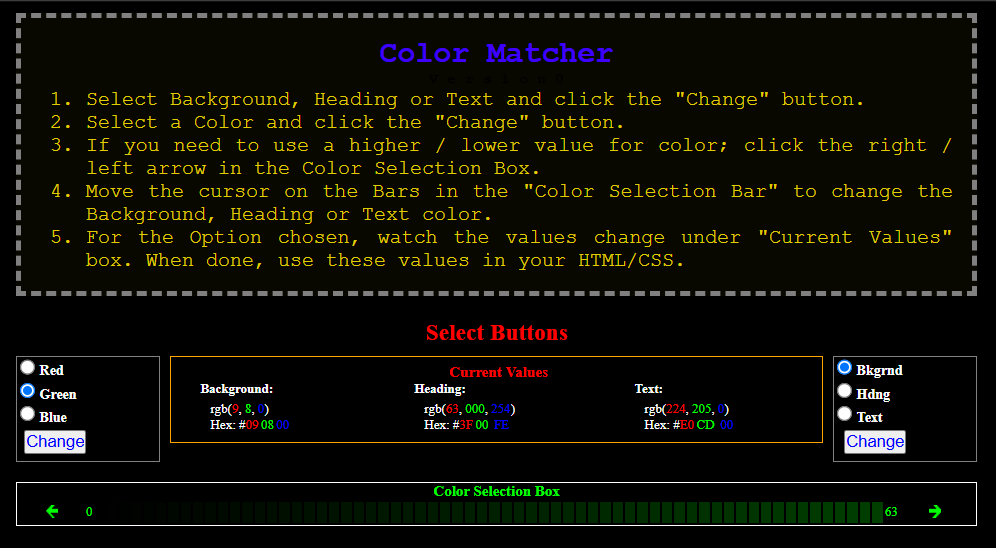
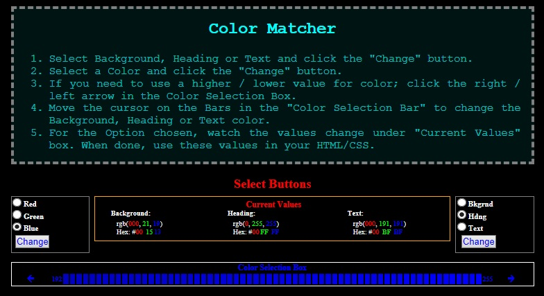
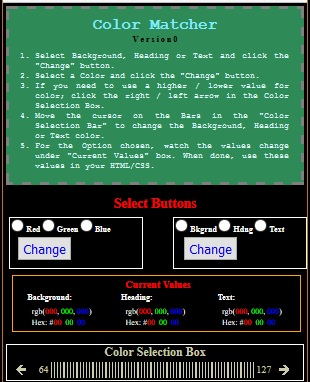

# ColorMatcher
ColorMatcher is an easy-to-use color design tool that helps users create and experiment with matching color schemes for web pages, blogs, student projects, and other screen-based applications.
The program allows you to independently adjust the colors of backgrounds, text, and headings while instantly viewing the results. This makes it easy to find attractive and readable color combinations before applying them to your website or project.
## Features
•	Independently modify background, text, and heading colors.
•	Freely switch between background, text, and heading editing without losing any previously selected color values.
•	Experiment with unlimited color combinations until the desired appearance is achieved.
•	Displays both RGB (Decimal) and Hexadecimal color values for every color selection.
•	Remembers the current color values for each element, allowing you to continue refining your design at any time.
•	Supports full color mixing using values from 0 to 255 for Red, Green, and Blue, rather than limiting users to predefined colors.
•	Provides an instant preview of all color changes.

## How It Works
1.	Select whether you want to work on the Background, Text, or Heading color.
2.	Choose the color component you wish to adjust.
3.	Move the pointer within the Color Selection Box to modify the color values.
4.	Observe the changes immediately in the preview area.
5.	Continue adjusting and fine-tuning colors until you achieve the desired result.
ColorMatcher keeps track of the current color settings for each element. You can switch freely between Background, Text, and Heading customization without losing the colors you have already created.
When working on any element, such as Text, the program remembers the intermediate color values you create while mixing colors. This allows continuous experimentation and refinement until the exact shade is achieved.

## Output
As colors are modified, ColorMatcher displays:
- RGB (Decimal) values
- Hexadecimal values

Once you have found the desired combination, simply copy these values into your HTML or CSS code.

## Intended Users
ColorMatcher is useful for:
- Web designers
- Students
- Teachers
- Hobbyists
- Anyone creating websites, blogs, or digital projects

### Screen Size
ColorMatcher is optimized for larger screens such as desktop and laptop computers. It also functions on smaller screens, although some features may have minor limitations due to the reduced display area.
________________________________________

### Screenshots

#### Main Applictaion Window

#### Example Color Combination

#### Example On a smaller screen

________________________________________

### Feature 1
ColorMatcher preserves the current color settings for Background, Text, and Heading independently, allowing users to switch freely between them without losing previously selected colors.

### Feature 2
While adjusting a color, ColorMatcher remembers the current RGB values being used. This makes it possible to experiment with multiple color combinations and continue refining them until the desired shade is achieved.
